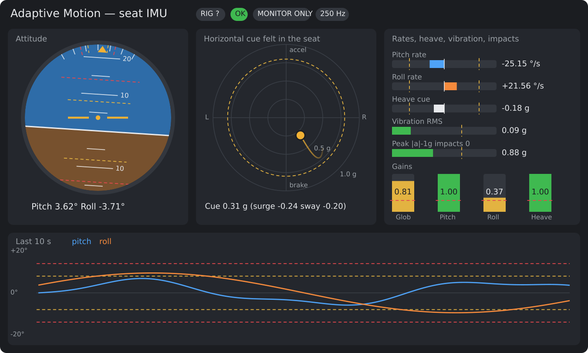
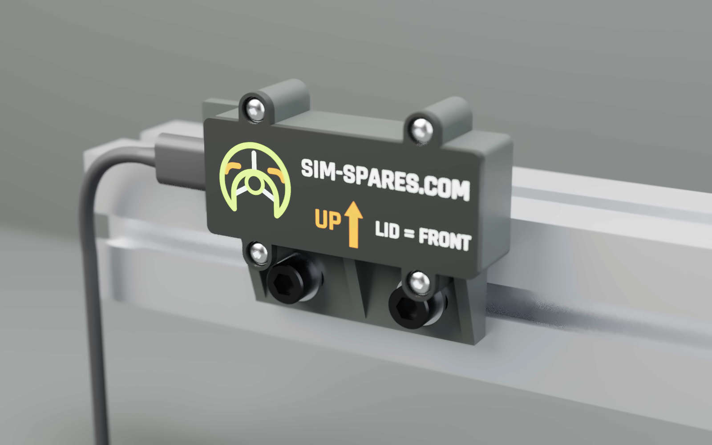
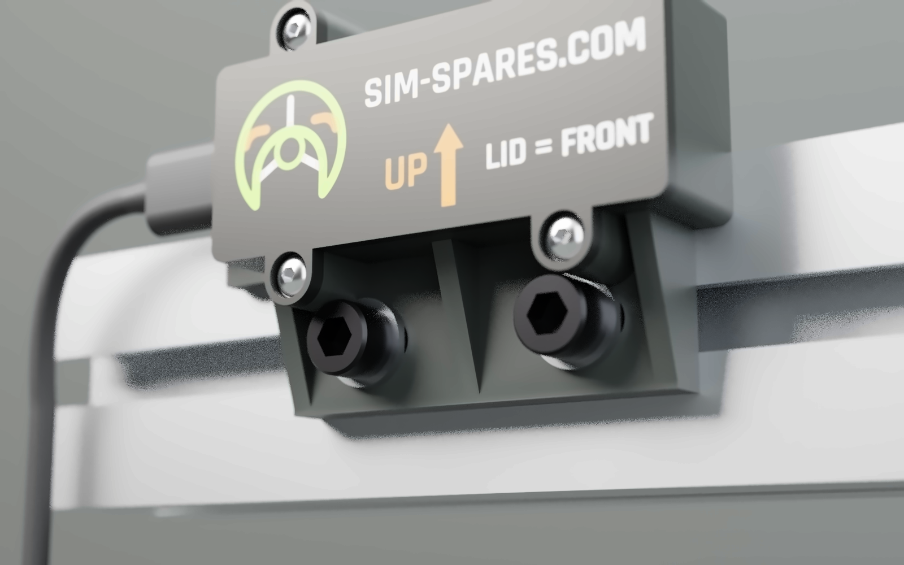
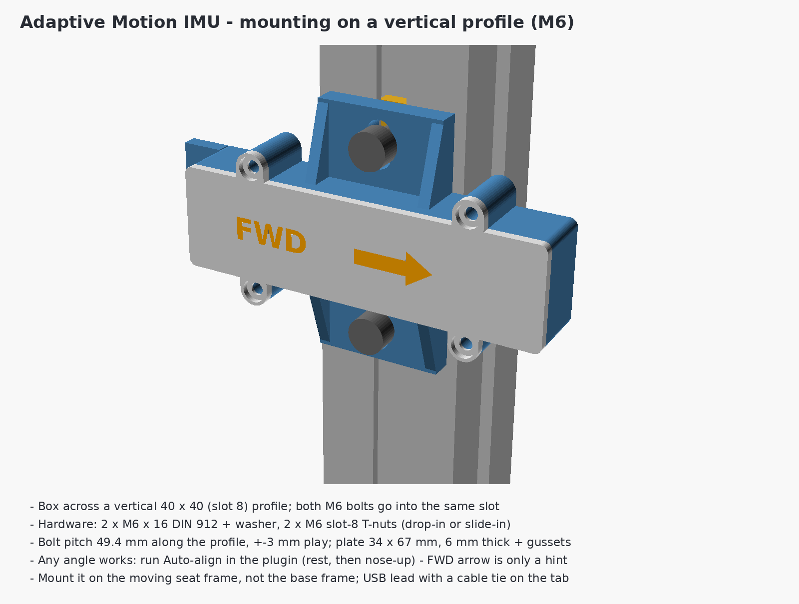

# AdaptiveMotionIMU

Closed-loop motion for SimHub: an MPU-6050 on the seat (ProMicro nRF52840, USB-C) measures what the rig really does,
and a SimHub plugin attenuates motion when the seat approaches limits you set.

```
firmware/
  AdaptiveMotionIMU/AdaptiveMotionIMU.ino   sketch (Arduino IDE 2: Board = "AliExpress ProMicro nRF52840")
  AdaptiveMotionIMU_promicro_nrf52840.uf2   prebuilt image: drag onto the NICENANO drive (no IDE needed)
  AdaptiveMotionIMU_promicro_nrf52840.hex   same, Intel HEX (app at 0x26000, S140 6.1.1 bootloader)
  AdaptiveMotionIMU_micro.hex / _nano.hex   legacy AVR images (Arduino Micro / Nano)
  PROTOCOL.md                               frame + command reference
  build_nrf.sh                              compile for the nRF52840 with arduino-cli + ArduinoNRF core
  build_check.sh                            compile the AVR variants with plain avr-gcc
  tools/hex2uf2.py                          HEX -> UF2 (family 0xADA52840)
  host_test/                                runs the real sketch on a PC with a fake MPU, writes frames.bin
plugin/SimSpares.AdaptiveMotion/
  SimSpares.AdaptiveMotion.csproj           net48, references SimHub from C:\Program Files (x86)\SimHub
  AdaptiveMotionPlugin.cs                   SimHub glue (properties, actions, events, settings)
  SettingsControl.cs                        settings page (code-built WPF)
  Core/                                     SimHub-independent logic (tested)
  IO/                                       serial link + UDP proxy
  Tests/CoreTests.cs                        65 tests
  UI/MotionVisualizer.cs                    live view (horizon, g-g, meters, gains, 10 s trend)
  UI/VisualizerWindow.cs                    pop-out window for a second screen
plugin/tools/check.sh                       Mono: tests + stub compile + live-view preview render: mcs -out:t.exe Tests/CoreTests.cs Core/*.cs && mono t.exe frames.bin
enclosure/
  adaptive_motion_imu_enclosure.scad        parametric source
  base.stl, lid.stl                         print-ready, sized for the ProMicro nRF52840 (board="micro" for the old Micro)
  lid_inlay_green/_orange/_white.stl        Sim-Spares logo + SIM-SPARES.COM + UP marking, one body per MMU3 colour
  lid_inlay.stl                             the same artwork as one body (single inlay colour)
  fonts/Rajdhani-Bold.ttf                   Sim-Spares brand font (SIL OFL), used by the SCAD (lid + inlay share coordinates for the MMU3)
  preview.png, preview_base.png
  fit_figure.py                             annotated fit picture -> docs/enclosure_fit.png (parts "fit" / "exploded")
```

## Controller board: ProMicro nRF52840 (Editing_PC or RYZEN-Racing)
The board is a nice!nano v2 clone (nRF52840, USB-C, **3.3 V logic**, Adafruit UF2 bootloader). Because it is
3.3 V like the GY-521, **no level shifter** is used: four wires, board straight to the sensor.

| GY-521 pin | Board pad (silk) | Note |
|---|---|---|
| VCC | `VCC` (+Y edge, 4th pad from USB) | 3.3 V output, switched by P0.13; firmware switches it on and auto-detects the polarity |
| GND | `GND` (-Y edge, 3rd pad) | |
| SDA | `1.00` (-Y edge, 9th pad) | Arduino D6, the core's default SDA |
| SCL | `0.11` (-Y edge, 10th pad) | Arduino D7, the core's default SCL |
| AD0, INT, XDA, XCL | not connected | AD0 has a pull-down on the module → address 0x68 |

Keep pads 5–8 on both edges free of solder blobs: the lid ribs press on that part of the PCB edge.

**Flash without an IDE:** double-tap RST→GND quickly; a drive **NICENANO** appears. Copy
`firmware/AdaptiveMotionIMU_promicro_nrf52840.uf2` onto it; the board reboots into the firmware
(check `INFO_UF2.TXT` on the drive says SoftDevice S140 6.1.1 — the image starts at 0x26000).
**With the Arduino IDE 2:** File → Preferences → Additional boards manager URLs:
`https://raw.githubusercontent.com/dunknowcoding/ArduinoNRF/main/package_arduinonrf_index.json` →
Boards Manager "ArduinoNRF" → Board **AliExpress ProMicro nRF52840** → Upload.
Check: open the COM port at any baud with DTR on, send `INFO` → `INFO fw=1.2.0 who=0x68 …`. LED: steady =
sensor OK + host connected, slow blink = waiting for SimHub, fast blink = no sensor (check the four wires).

## Build the plugin (RYZEN-Racing)
1. Install the .NET Framework 4.8 Developer Pack and the .NET SDK (or Visual Studio 2022).
2. Close SimHub. `cd plugin/SimSpares.AdaptiveMotion && dotnet build -c Release`
   (DLL is copied into the SimHub folder; run the shell as admin or pass `-p:DeployToSimHub=false` and copy by hand).
3. Start SimHub → enable the plugin when asked → left menu "Adaptive Motion".

## Live view
SimHub → Adaptive Motion → **Live view** tab (or **Pop out window** for a second screen / the rig display):



- **Attitude**: artificial horizon of the seat (pitch ladder, roll scale), yellow = comfort limit, red = hard trip.
- **Horizontal cue**: g-g plot of the force felt in the seat with a 2 s trail; dashed ring = cue limit.
- **Meters**: pitch/roll rate, heave cue, vibration RMS, peak |a|−1 g (impact threshold) and the impact count.
- **Gains**: what the controller currently applies (red line = minimum gain).
- **Last 10 s**: pitch and roll trend against the limits.
- Header badges: controller status, mode, sensor rate, STILL, MOUNT SHIFTED, CLONE IMU, LEVEL NOT CAPTURED.
(The preview image is rendered off-Windows through an SVG stand-in, so fonts differ slightly from SimHub.)

## Mounting
Default `mount_style = "side"`: the box lies along a horizontal 30/40-series slot-8 cross-member, bolted to
its vertical side face; a 6 mm flange along the box's long side carries two M6 bolts 32 mm apart (±3 mm play),
both in that face's horizontal slot. The box sits beside the slot (above it, or below it if you flip it).
Hardware: 2 × M6 × 16 DIN 912 + washers, 2 × M6 slot-8 T-nuts. Print `base.stl` (side), or
`base_across.stl` (box across a vertical upright) / `base_along.stl` (ears at the ends) for other mounts.
The box does not have to be square to the rig: use **Auto-align** (below).





(Photo renders: `enclosure/render/render.sh` — OpenSCAD scene with DIN 912 M6 × 16 black-oxide bolts, DIN 125 washers,
slot-8 drop-in T-nuts, ISO 7380 M3 lid screws and a USB-C lead, rendered in Blender Cycles.)



**Lid print (Prusa MK3.5S + MMU3):** load `lid.stl` and the three `lid_inlay_*.stl` together as one multi-part
object (they share coordinates), lid in black/carbon PETG, inlays green #A6FF4D, orange #FF7A29, white #F3F5F1.
The artwork is the bottom 0.6 mm (printed face-down on a textured or smooth sheet), so the colour changes
only happen in the first three layers. Use 0.2 mm first layer and "Arachne" perimeters for the small text.


## Calibration
- **Auto-align (any mounting angle)**: 1) rig at centre, still → *Auto-align 1: rest*; 2) pitch the rig
  nose-up ≥ 2° (pure pitch, e.g. SimHub/nullCAT manual move) and hold → *Auto-align 2: nose-up*.
  The plugin derives the rig's up and forward axes in sensor coordinates (and sets level). Re-run it
  whenever the box is re-mounted. The manual axis pickers remain for square mounts.
- **Gyro bias** is learned automatically by the firmware whenever the rig is still for 2 s (AUTOCAL, on by default),
  so it follows the sensor as it warms up. `GyroCalibrate` remains for a forced 2 s calibration.
- **Level** is captured once, with the rig at its *centre* position (`CaptureLevel`) — never automatically,
  because the park position is not necessarily level.
- **Park check**: when no game runs and the rig is still, the plugin averages the parked pose and compares it with
  the pose learned at the first park. A difference above 0.5° raises the `MountShifted` event / `Park.MountShifted`
  property (IMU box moved, or the rig homed/parked elsewhere). It warns only. `RelearnParkPose` after re-mounting.

## Safety
The plugin only ever attenuates (gains in [MinGain, 1]) and never moves an actuator further from neutral than
SimHub's own packet did. It is NOT a safety system: keep the hardware e-stop and verify nullCAT parks on
UDP loss before using the proxy.

See the design doc for the full investigation, control law and bring-up plan.
